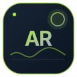
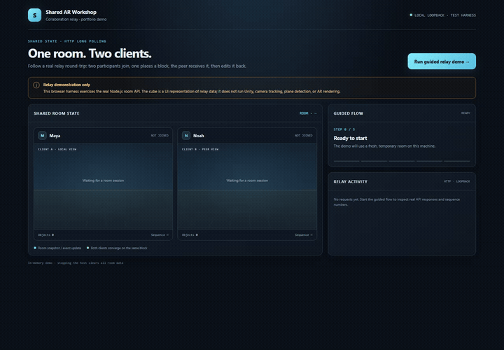

<p align="center">
  
</p>

<h1 align="center">Shared AR Workshop</h1>

<p align="center"><strong>A Unity mobile AR prototype for placing and editing shared objects in a room.</strong></p>

<p align="center">   </p>

Shared AR Workshop combines an AR Foundation client with a small Node.js room relay. The Unity source includes plane-aware placement, manual room alignment, block editing, local save/load, and HTTP long-polling for shared changes.

> **Status: prototype.** The browser walkthrough exercises the room relay only. The Unity project has not been built or verified on an AR device in this workspace. It requires Unity `6000.3.0f1`; the installed editor is `6000.6.3f1`. No APK, iOS build, or device-to-device AR recording is included.

<p align="center"><a href="#browser-relay-walkthrough">Relay walkthrough</a> &nbsp;·&nbsp; <a href="#run-locally">Run locally</a> &nbsp;·&nbsp; <a href="#verification-and-limitations">Verification</a> &nbsp;·&nbsp; <a href="#license">License</a></p>

## What the source contains

- AR Foundation plane detection and camera tracking.
- A manual two-point coordinate alignment flow using a local AR anchor. It is not cloud-anchor localization.
- Block placement and deletion, local physics demonstration, and JSON save/load.
- A Node.js relay for room joining, initial state snapshots, block upserts/deletes, and HTTP long-poll event delivery.

These are implemented code paths, not a claim that the Unity application has been compiled or exercised on a phone. Shared alignment accuracy and multi-device AR behavior still need a device demonstration.

## Browser relay walkthrough

The dependency-free browser harness starts the Node relay and presents two independent clients. The guided flow joins a room, publishes a block, delivers the event to the peer, edits the block from that peer, and confirms both browser-side states reach the same sequence.

<p align="center"><a href="docs/media/shared-ar-relay-demo.mp4"></a></p>

The short video is assembled from timed browser captures with a visible guide pointer; it is not a continuous Unity or AR-device recording. The cube is a visual representation of relay data. The demo does not run Unity, camera tracking, plane detection, or AR rendering.

The harness detects the relay protocol from its join response. The currently committed `main` relay uses a **legacy caller-supplied `clientId`** as its room membership value. That value is not authentication; keep this prototype on loopback and do not expose the relay to the internet. The walkthrough displays this warning when it detects the legacy API.

## Run locally

Requirements: Node.js 20 or later. The browser harness and relay use Node.js built-in modules; Docker and an Android emulator are not needed.

From the repository root:

```sh
node tools/relay-demo/host.mjs
```

Open the loopback URL printed in the terminal and select **Run guided relay demo**. The script starts the web page and relay on temporary loopback ports. Press `Ctrl+C` in that terminal to stop both processes; room state is held in memory and is cleared on shutdown.

To run the relay API without the browser harness:

```sh
node server/server.js
```

The API binds to `127.0.0.1:8787` by default. Avoid binding the legacy relay to a public or shared network interface.

## Unity project

Requirements for the app: Unity **6000.3.0f1**, Android Build Support with SDK/NDK and OpenJDK, and an ARCore-supported Android device. iOS builds require macOS, Xcode, and an ARKit-capable device. A two-device demo needs two compatible phones on the same reachable network.

1. Open `UnityProject` with Unity 6000.3.0f1 and allow Package Manager to resolve the dependencies listed in `UnityProject/Packages/manifest.json`.
2. Configure the ARCore or ARKit loader for the target platform.
3. Build and run on an AR-capable device.
4. Join the same relay room from two devices, align each device manually using the same two physical points, then place and edit blocks.

Manual alignment is approximate. The project does not implement cloud anchors or a shared-world-map service.

## Relay API

| Method | Endpoint | Purpose |
| --- | --- | --- |
| `GET` | `/health` | Process status and in-memory room counts |
| `POST` | `/api/rooms/:code/join` | Join a room and receive a snapshot plus `clientId` |
| `GET` | `/api/rooms/:code/events?clientId=:id&since=:seq` | Long-poll for events after a sequence number |
| `POST` | `/api/rooms/:code/objects/upsert` | Create or update a block |
| `POST` | `/api/rooms/:code/objects/delete` | Delete a block |

The relay stores rooms in process memory. It has no user accounts, authenticated identity, room roles, durable storage, or moderation. Room members can edit room objects. It includes basic payload, room, member, object, event-history, and operation-rate limits, but those limits do not replace authentication. See [`server/README.md`](server/README.md) for the relay request format and current limits.

## Verification and limitations

- `npm --prefix server run check` checks the relay JavaScript syntax.
- `npm --prefix server test` runs the relay API tests.
- Verified on Node.js `v24.12.0` against a clean copy of the relay source from the committed `main`: the syntax check passed and all 4 API tests passed. The browser harness completed two joins, two upserts, and peer event delivery; both clients reached sequence 2 with no page or console errors.
- The server workflow checks syntax, API behavior, dependency advisories, and the Unity package manifest. The Android workflow is manual and requires Unity licensing secrets; neither workflow compiles the Unity C# project locally.
- Unity compilation, Android/iOS packaging, AR tracking, two-device synchronization, and performance have not been verified in this workspace.
- The relay is in-memory and intended for local demonstration. The committed `clientId` protocol is not suitable for public deployment.
- The browser walkthrough does not measure device synchronization latency or frame rate.

## Repository layout

```text
UnityProject/Assets/SharedWorkshop/Runtime/  # AR interaction, block model, relay client, HUD
UnityProject/Packages/manifest.json          # pinned direct Unity dependencies
server/server.js                             # in-memory Node.js room relay
server/test/server.test.js                   # relay API tests
tools/relay-demo/                            # loopback browser walkthrough
docs/media/                                   # walkthrough video, preview, and screenshots
```

## License

MIT. See [LICENSE](LICENSE). Third-party dependencies and assets remain under their respective licenses.
